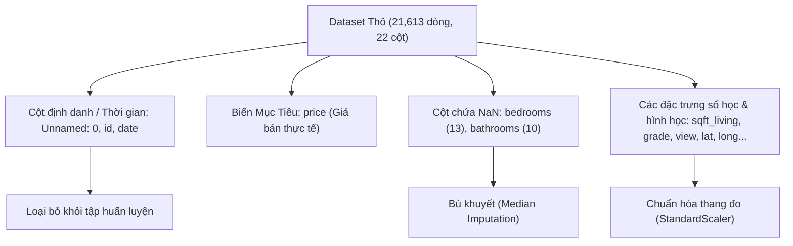
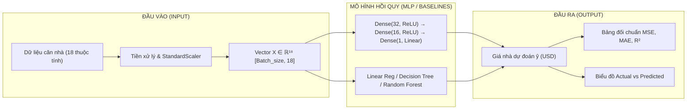
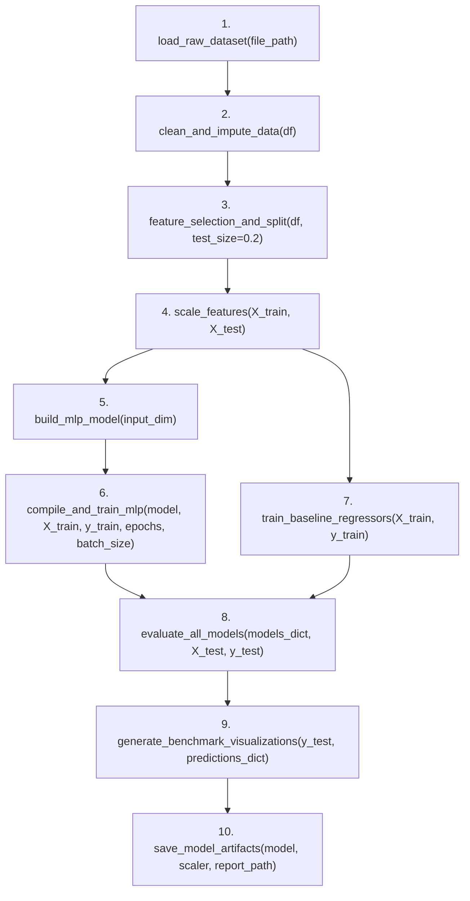
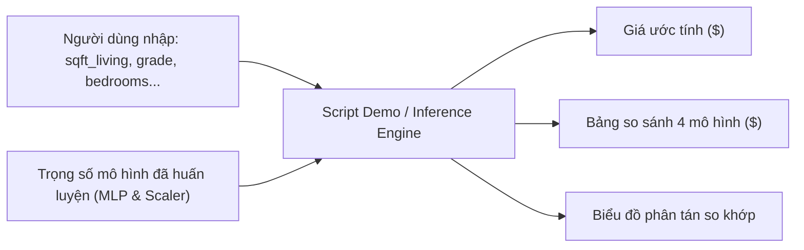

# TÀI LIỆU THIẾT KẾ HỆ THỐNG (DESIGN DOCUMENT)
## Dự án: Dự Đoán Giá Nhà Sử Dụng Mạng Nơ-ron Nhân Tạo Multilayer Perceptron (MLP) & Đánh Giá Đối Chuẩn

---

## 1. Introduction (Giới thiệu & Khảo sát Dữ liệu)

### 1.1 Nguồn gốc Dataset
Tập dữ liệu được sử dụng trong dự án là **King County House Sales dataset** (bang Washington, Hoa Kỳ), được lưu trữ tại đường dẫn:
`data/kc_house_data_NaN/data_raw/kc_house_data_NaN.csv`.

Tập dữ liệu này ghi nhận thông tin giao dịch mua bán nhà ở thực tế tại khu vực King County (bao gồm thành phố Seattle và các vùng phụ cận) từ tháng 5/2014 đến tháng 5/2015. Đây là một trong những bộ dữ liệu chuẩn mực và thực tế nhất dùng để nghiên cứu bài toán Hồi quy giá bất động sản (House Price Prediction).

### 1.2 Phân tích tổng quan dữ liệu
- **Tổng số dòng (Samples / Instances):** `21,613` dòng quan sát.
- **Tổng số cột (Attributes / Features):** `22` cột (bao gồm 1 biến mục tiêu `price`, 18 đặc trưng mô tả bất động sản, và 3 cột định danh/thời gian kỹ thuật).
- **Tình trạng giá trị khuyết (Missing Values):**
  - `bedrooms`: Khuyết **13** giá trị (cần xử lý bù khuyết bằng trung vị - median hoặc mode).
  - `bathrooms`: Khuyết **10** giá trị (cần xử lý bù khuyết bằng trung vị - median).
  - Các đặc trưng còn lại đầy đủ 100% dữ liệu (không có null).



---

### 1.3 Phân loại đặc trưng theo mức độ tác động đến giá nhà (`price`)

Dựa trên phân tích hệ số tương quan tuyến tính Pearson ($r$) với biến mục tiêu `price` và đặc thù kinh tế học bất động sản, các đặc trưng được phân thành 4 nhóm tác động chính:

| Tên Đặc trưng | Ý nghĩa nghiệp vụ | Kiểu dữ liệu | Hệ số tương quan ($r$) | Mức độ tác động | Phương án xử lý |
| :--- | :--- | :---: | :---: | :---: | :--- |
| **sqft_living** | Diện tích không gian sống (sqft) | `int64` | **+0.7020** | **Rất mạnh (High)** | Giữ lại, chuẩn hóa (`StandardScaler`) |
| **grade** | Điểm phân cấp chất lượng xây dựng (1-13) | `int64` | **+0.6674** | **Rất mạnh (High)** | Giữ lại, chuẩn hóa |
| **sqft_above** | Diện tích phần nhà trên mặt đất (sqft) | `int64` | **+0.6056** | **Mạnh (High)** | Giữ lại, chuẩn hóa |
| **sqft_living15**| Diện tích không gian sống của 15 căn lân cận | `int64` | **+0.5854** | **Mạnh (High)** | Giữ lại, chuẩn hóa |
| **bathrooms** | Số phòng tắm / vệ sinh | `float64` | **+0.5259** | **Mạnh (High)** | Điền khuyết (Median), chuẩn hóa |
| **view** | Điểm đánh giá hướng nhìn/cảnh quan (0-4) | `int64` | **+0.3973** | **Trung bình (Moderate)** | Giữ lại, chuẩn hóa |
| **sqft_basement**| Diện tích tầng hầm (sqft) | `int64` | **+0.3238** | **Trung bình (Moderate)** | Giữ lại, chuẩn hóa |
| **bedrooms** | Số lượng phòng ngủ | `float64` | **+0.3089** | **Trung bình (Moderate)** | Điền khuyết (Median), chuẩn hóa |
| **lat** | Vĩ độ địa lý (Latitude) | `float64` | **+0.3070** | **Trung bình (Moderate)** | Giữ lại (quyết định vị trí trung tâm) |
| **waterfront** | Giáp mặt nước / bờ sông, hồ (0/1) | `int64` | **+0.2664** | **Trung bình (Moderate)** | Giữ lại (yếu tố bất động sản cao cấp) |
| **floors** | Số tầng của căn nhà | `float64` | **+0.2568** | **Trung bình (Moderate)** | Giữ lại, chuẩn hóa |
| **yr_renovated** | Năm cải tạo gần nhất | `int64` | **+0.1264** | **Yếu (Low)** | Giữ lại / tạo biến cờ (Đã cải tạo hay chưa) |
| **sqft_lot** | Diện tích toàn bộ khuôn viên đất | `int64` | **+0.0897** | **Yếu (Low)** | Giữ lại, log-transform hoặc chuẩn hóa |
| **sqft_lot15** | Diện tích đất khuôn viên của 15 căn lân cận | `int64` | **+0.0824** | **Yếu (Low)** | Giữ lại, chuẩn hóa |
| **yr_built** | Năm xây dựng căn nhà | `int64` | **+0.0540** | **Yếu (Low)** | Giữ lại / tính tuổi nhà (`age = 2015 - yr_built`) |
| **condition** | Tình trạng bảo trì ngôi nhà (1-5) | `int64` | **+0.0364** | **Yếu (Low)** | Giữ lại, chuẩn hóa |
| **long** | Kinh độ địa lý (Longitude) | `float64` | **+0.0216** | **Yếu (Low)** | Kết hợp với `lat` định vị không gian |
| **zipcode** | Mã bưu điện khu vực | `int64` | **-0.0532** | **Phi tuyến (Nonlinear)**| Có tính phân cụm vị trí, mã hóa phù hợp |
| **id**, **Unnamed: 0**| Mã định danh căn nhà & index | `int64` | ~0.00 | **Không tác động (Noise)** | **Loại bỏ (Drop)** |
| **date** | Ngày giao dịch mua bán | `object` | N/A | **Nhiễu thời gian ngắn** | Loại bỏ hoặc trích xuất năm/tháng |

---

## 2. Purpose (Mục Đích Bài Toán)

### 2.1 Bối cảnh và Bài toán
Thị trường bất động sản là một hệ thống định giá phức tạp với mối quan hệ phi tuyến cao giữa các thuộc tính vật lý (diện tích, cấu trúc), chất lượng xây dựng và vị trí địa lý. Việc ước lượng chính xác giá trị bất động sản đóng vai trò sống còn trong quản trị rủi ro tín dụng, thẩm định giá và ra quyết định đầu tư.

### 2.2 Mục tiêu kỹ thuật
1. **Xây dựng mô hình Hồi quy Mạng nơ-ron đa tầng (Multilayer Perceptron - MLP Regression)**:
   - Áp dụng kiến trúc mạng truyền thẳng (Feedforward Neural Network) với các hàm kích hoạt phi tuyến (ReLU) nhằm học được các biểu diễn phức tạp và tương tác ẩn giữa các biến độc lập.
   - Tối ưu hóa hàm mất mát lỗi bình phương trung bình ($\text{MSE}$) bằng giải thuật tối ưu thích nghi Adam.
2. **Khảo sát & Đối chuẩn Hiệu năng Toàn diện (Model Benchmarking)**:
   - Theo yêu cầu đề bài, thiết lập một khung so sánh công bằng giữa mô hình **MLP** với các giải thuật Học máy kinh điển:
     - **Linear Regression**: Mô hình chuẩn tuyến tính (Baseline).
     - **Decision Tree Regression**: Mô hình cây phi tuyến đơn lẻ.
     - **Random Forest Regression**: Mô hình học tăng cường kết hợp (Ensemble Bagging).
3. **Phân tích so sánh**:
   - So sánh định lượng qua các độ đo sai số chuẩn ($\text{MSE}$, $\text{MAE}$, $R^2$).
   - Phân tích ưu/nhược điểm của từng kiến trúc khi đối mặt với dữ liệu có độ lệch phân phối và quan hệ phi tuyến.

---

## 3. Input / Output Specification (Đặc Tả Đầu Vào & Đầu Ra)



### 3.1 Cấu trúc Đầu vào (Input Specification)
- **Hình thức tiếp nhận**:
  - Khi huấn luyện: Ma trận đặc trưng số học $X_{\text{train}} \in \mathbb{R}^{N \times d}$ và $X_{\text{test}} \in \mathbb{R}^{M \times d}$ với $d = 18$ đặc trưng.
  - Khi suy luận (Inference/Demo): Một vector $x \in \mathbb{R}^{18}$ chứa các thông số mô tả của một căn nhà cụ thể.
- **Danh sách 18 đặc trưng đầu vào chuẩn hóa**:
  `[bedrooms, bathrooms, sqft_living, sqft_lot, floors, waterfront, view, condition, grade, sqft_above, sqft_basement, yr_built, yr_renovated, zipcode, lat, long, sqft_living15, sqft_lot15]`
- **Ràng buộc tiền xử lý**: Toàn bộ các đặc trưng phải được chuẩn hóa qua `StandardScaler`:
  $$\mu = 0, \quad \sigma = 1$$

### 3.2 Cấu trúc Đầu ra (Output Specification)
- **Đại lượng đầu ra**:
  - Giá trị vô hướng $\hat{y} \in \mathbb{R}^+$ biểu diễn giá nhà dự đoán (đơn vị: Đô la Mỹ - USD).
  - Shape tensor đầu ra: `(batch_size, 1)`.
- **Hàm kích hoạt tầng ra**: Tuyến tính (Linear / Identity: $f(z) = z$), cho phép mô hình dự báo không gian giá trị liên tục không bị giới hạn trong khoảng $[0, 1]$.
- **Kết quả đối chuẩn (Benchmark Output)**: Bảng tổng hợp so sánh các chỉ số hiệu năng và trực quan hóa so khớp giữa giá thực tế và giá dự đoán.

---

## 4. Evaluation (Phương Pháp & Tiêu Chí Đánh Giá Mô Hình)

### 4.1 Các chỉ số đánh giá (Evaluation Metrics)

Để đánh giá toàn diện độ chính xác và độ lệch của mô hình hồi quy, 4 chỉ số chuẩn hóa được áp dụng:

1. **Mean Squared Error (MSE)**:
   - Đo lường trung bình bình phương khoảng cách sai lệch giữa giá trị dự đoán và giá trị thực tế.
   - Do có lũy thừa bậc 2, MSE phạt rất nặng các trường hợp dự đoán sai lệch lớn (outliers).
   $$\text{MSE} = \frac{1}{n} \sum_{i=1}^{n} (y_i - \hat{y}_i)^2$$

2. **Root Mean Squared Error (RMSE)**:
   - Căn bậc hai của MSE, đưa sai số về cùng đơn vị đo với biến mục tiêu (USD), giúp người thẩm định dễ hình dung độ lệch trung bình thực tế.
   $$\text{RMSE} = \sqrt{\frac{1}{n} \sum_{i=1}^{n} (y_i - \hat{y}_i)^2}$$

3. **Mean Absolute Error (MAE)**:
   - Trung bình giá trị tuyệt đối của sai số. MAE phản ánh độ lệch giá trung bình mà không bị khuếch đại bởi các căn nhà ngoại lệ cực đắt hoặc cực rẻ.
   $$\text{MAE} = \frac{1}{n} \sum_{i=1}^{n} |y_i - \hat{y}_i|$$

4. **Hệ số xác định $R^2$ (R-squared Score)**:
   - Tỷ lệ phương sai của giá nhà được mô hình giải thích. $R^2 \in (-\infty, 1]$, giá trị càng tiệm cận $1.0$ thể hiện mô hình khớp và dự đoán càng chuẩn xác.
   $$R^2 = 1 - \frac{\sum_{i=1}^n (y_i - \hat{y}_i)^2}{\sum_{i=1}^n (y_i - \bar{y})^2}$$

---

### 4.2 Khung so sánh đối chuẩn (Model Benchmarking Framework)

Theo yêu cầu đề bài, mô hình mạng nơ-ron MLP sẽ được đặt trong thế đối chiếu với 3 mô hình học máy truyền thống trên cùng một tập kiểm thử ($X_{\text{test}}, y_{\text{test}}$) được chia ngẫu nhiên tỉ lệ 80:20:

| Mô hình | Nguyên lý hoạt động | Ưu điểm cốt lõi | Nhược điểm / Rủi ro |
| :--- | :--- | :--- | :--- |
| **Linear Regression** | Tìm siêu phẳng tối ưu minimizing OLS: $\hat{y} = X\beta$ | Tốc độ huấn luyện tức thì, tính diễn giải (interpretability) cao nhất. | Chỉ nắm bắt quan hệ tuyến tính, sai số lớn khi dữ liệu có tương tác phức tạp. |
| **Decision Tree Regression** | Phân chia không gian đặc trưng bằng các ngưỡng trực giao nhị phân (CART). | Không đòi hỏi giả định phân phối, học được các ngưỡng phi tuyến. | Cực kỳ nhạy cảm với dữ liệu huấn luyện, dễ bị overfitting nặng nếu không tỉa cành. |
| **Random Forest Regression** | Tập hợp đa cây quyết định độc lập (Bagging) và lấy trung bình dự đoán. | Giảm thiểu variance, chống overfitting mạnh mẽ, độ chính xác cao trên dữ liệu bảng. | Tiêu tốn bộ nhớ, mô hình hộp đen khó giải thích từng quyết định riêng lẻ. |
| **Multilayer Perceptron (MLP)** | Mạng nơ-ron đa tầng với liên kết đầy đủ (Dense) và hàm kích hoạt phi tuyến ReLU. | Khả năng xấp xỉ hàm vạn năng (Universal Approximation), học biểu diễn tiềm ẩn sâu. | Cần dữ liệu chuẩn hóa cẩn thận, nhạy cảm với siêu tham số (learning rate, epochs). |

---

## 5. How It Works (Nguyên Lý Hoạt Động, Mã Giả & Quy Trình)

### 5.1 Kiến trúc mạng Multilayer Perceptron (MLP)

Mô hình gồm 3 tầng liên kết đầy đủ (Dense layers):
- **Tầng ẩn 1 (Hidden Layer 1)**: `Dense(32, activation='relu', input_dim=18)`
- **Tầng ẩn 2 (Hidden Layer 2)**: `Dense(16, activation='relu')`
- **Tầng đầu ra (Output Layer)**: `Dense(1, activation='linear')`

```
   [Vector Đầu Vào X: 18 đặc trưng]
                  │
                  ▼
   ┌──────────────────────────────┐
   │    Dense 32 nơ-ron (ReLU)    │ ───► z¹ = W¹X + b¹, a¹ = max(0, z¹)
   └──────────────────────────────┘
                  │
                  ▼
   ┌──────────────────────────────┐
   │    Dense 16 nơ-ron (ReLU)    │ ───► z² = W²a¹ + b², a² = max(0, z²)
   └──────────────────────────────┘
                  │
                  ▼
   ┌──────────────────────────────┐
   │     Dense 1 nơ-ron (Linear)  │ ───► ŷ = W³a² + b³ (Giá nhà dự đoán USD)
   └──────────────────────────────┘
```

---

### 5.2 Nền tảng Toán học (Mathematical Formulations)

#### 1. Chuẩn hóa đặc trưng (Z-score Standardization)
Mỗi đặc trưng $j$ trong tập huấn luyện được dịch chuyển về phân phối có kỳ vọng bằng 0 và độ lệch chuẩn bằng 1:
$$x'_{ij} = \frac{x_{ij} - \mu_j}{\sigma_j}, \quad \text{trong đó } \mu_j = \frac{1}{N}\sum_{i=1}^N x_{ij}, \quad \sigma_j = \sqrt{\frac{1}{N}\sum_{i=1}^N (x_{ij} - \mu_j)^2}$$

#### 2. Lan truyền xuôi (Forward Propagation)
- **Tầng ẩn 1**:
  $$z^{[1]} = W^{[1]} \cdot x + b^{[1]}, \quad a^{[1]} = \text{ReLU}(z^{[1]}) = \max(0, z^{[1]})$$
- **Tầng ẩn 2**:
  $$z^{[2]} = W^{[2]} \cdot a^{[1]} + b^{[2]}, \quad a^{[2]} = \text{ReLU}(z^{[2]}) = \max(0, z^{[2]})$$
- **Tầng đầu ra**:
  $$\hat{y} = z^{[3]} = W^{[3]} \cdot a^{[2]} + b^{[3]}$$

#### 3. Hàm mất mát (Loss Function - Mean Squared Error)
Với mini-batch gồm $B$ mẫu:
$$\mathcal{L}(W, b) = \frac{1}{B} \sum_{i=1}^{B} (y_i - \hat{y}_i)^2$$

#### 4. Lan truyền ngược (Backpropagation via Chain Rule)
- Đạo hàm tại tầng ra:
  $$\frac{\partial \mathcal{L}}{\partial z^{[3]}} = -\frac{2}{B}(y - \hat{y})$$
- Gradient đối với trọng số và bias tầng 3:
  $$\frac{\partial \mathcal{L}}{\partial W^{[3]}} = \frac{\partial \mathcal{L}}{\partial z^{[3]}} (a^{[2]})^T, \quad \frac{\partial \mathcal{L}}{\partial b^{[3]}} = \sum \frac{\partial \mathcal{L}}{\partial z^{[3]}}$$
- Gradient lan truyền ngược về tầng 2 qua đạo hàm ReLU:
  $$\frac{\partial \mathcal{L}}{\partial z^{[2]}} = \left( (W^{[3]})^T \frac{\partial \mathcal{L}}{\partial z^{[3]}} \right) \odot \mathbb{I}(z^{[2]} > 0)$$

#### 5. Giải thuật tối ưu hóa Adam (Adaptive Moment Estimation)
Tại bước lặp $t$, với gradient $g_t = \nabla_\theta \mathcal{L}_t$:
- Cập nhật mô-men bậc 1 (Moving Average of Gradients):
  $$m_t = \beta_1 m_{t-1} + (1 - \beta_1) g_t$$
- Cập nhật mô-men bậc 2 (Moving Average of Squared Gradients):
  $$v_t = \beta_2 v_{t-1} + (1 - \beta_2) g_t^2$$
- Hiệu chỉnh độ lệch khởi tạo (Bias Correction):
  $$\hat{m}_t = \frac{m_t}{1 - \beta_1^t}, \quad \hat{v}_t = \frac{v_t}{1 - \beta_2^t}$$
- Cập nhật trọng số tham số $\theta$:
  $$\theta_t = \theta_{t-1} - \frac{\eta}{\sqrt{\hat{v}_t} + \epsilon} \hat{m}_t$$
  *(Trong đó: learning rate $\eta = 0.001$, $\beta_1 = 0.9$, $\beta_2 = 0.999$, $\epsilon = 10^{-7}$)*.

---

### 5.3 Mã giả Thuật toán MLP Regression (Algorithm Pseudocode)

```text
Algorithm: MLP_House_Price_Regression_Training
Input:
    - Dataset D = {(x_i, y_i)} với i = 1 ... N
    - Hyperparameters: epochs = 100, batch_size = 32, learning_rate = 0.001
    - Tỷ lệ chia tập kiểm thử: test_size = 0.2
Output:
    - Mô hình mạng MLP đã hội tụ tối ưu M*
    - Các bộ tham số tối ưu (W*, b*)
    - Bộ chỉ số đánh giá trên tập kiểm thử: MSE, MAE, R2

BEGIN
    1. Tiền xử lý dữ liệu:
       - Loại bỏ các cột không mang thông tin dự báo: ['Unnamed: 0', 'id', 'date']
       - Bù khuyết giá trị NaN cho 'bedrooms' và 'bathrooms' bằng median của cột tương ứng.
       - Tách đặc trưng X và nhãn mục tiêu y = price.
       
    2. Phân chia tập dữ liệu:
       - (X_train, X_test, y_train, y_test) = Train_Test_Split(X, y, test_size=0.2, random_state=42)
       
    3. Chuẩn hóa thang đo (Feature Scaling):
       - Khởi tạo scaler = StandardScaler()
       - fit_transform trên tập huấn luyện: X_train_scaled = scaler.fit_transform(X_train)
       - transform trên tập kiểm tra: X_test_scaled = scaler.transform(X_test)
       
    4. Khởi tạo kiến trúc mạng nơ-ron:
       - Khởi tạo Sequential Model M
       - Layer 1: Dense(units=32, activation='relu', input_dim=X_train.shape[1])
       - Layer 2: Dense(units=16, activation='relu')
       - Output Layer: Dense(units=1, activation='linear')
       - Compile Model M với Optimizer='adam', Loss='mean_squared_error'
       
    5. Vòng lặp huấn luyện (Training Loop):
       FOR epoch = 1 TO epochs DO:
           - Xáo trộn (Shuffle) tập dữ liệu huấn luyện (X_train_scaled, y_train)
           - Chia thành các mini-batches kích thước batch_size = 32
           FOR each mini-batch (X_b, y_b) DO:
               - Forward Pass: Tính toán giá trị dự đoán y_hat qua Layer 1, 2 và Output
               - Loss Calculation: Tính batch_loss = (1 / B) * SUM((y_b - y_hat)^2)
               - Backward Pass: Lan truyền ngược tính toán gradients dW, db theo chuỗi chain rule
               - Weight Update: Cập nhật trọng số thông qua thuật toán tối ưu Adam
           - Đánh giá validation_loss trên tập (X_test_scaled, y_test)
           - Ghi nhận lịch sử huấn luyện (Loss, MAE)
       ENDFOR
       
    6. Đánh giá và Đối chuẩn (Evaluation & Benchmarking):
       - y_pred_mlp = M.predict(X_test_scaled)
       - Tính toán MSE, MAE, R2 cho MLP
       - Huấn luyện song song các mô hình: Linear Regression, Decision Tree, Random Forest
       - Tính toán MSE, MAE, R2 cho từng mô hình cơ sở
       - Trả về bảng so sánh đối chuẩn và xuất biểu đồ trực quan hóa
END
```

---

### 5.4 Quy trình Thực Hiện (Implementation Pipeline Sequence)

Quy trình triển khai mã nguồn được tổ chức tuần tự theo các hàm chức năng chuyên biệt (không viết code chi tiết ở tài liệu thiết kế):



1. **`load_raw_dataset(file_path: str) -> pd.DataFrame`**:
   - Đọc tệp tin `kc_house_data_NaN.csv` từ thư mục `data_raw/`.
2. **`clean_and_impute_data(df: pd.DataFrame) -> pd.DataFrame`**:
   - Loại bỏ các cột `['Unnamed: 0', 'id', 'date']`.
   - Thực hiện điền giá trị khuyết (Imputation) cho `bedrooms` và `bathrooms` bằng giá trị trung vị (`median`).
3. **`feature_selection_and_split(df: pd.DataFrame, test_size=0.2, random_state=42)`**:
   - Tách biến độc lập $X$ và biến phụ thuộc $y$ (`price`).
   - Phân tách dữ liệu thành 2 tập độc lập `train` và `test` theo tỷ lệ 80:20.
4. **`scale_features(X_train, X_test) -> Tuple[X_train_scaled, X_test_scaled, scaler]`**:
   - Áp dụng `StandardScaler()`. `fit_transform` trên `X_train` và `transform` trên `X_test` để tránh Data Leakage.
5. **`build_mlp_model(input_dim: int) -> tf.keras.Model`**:
   - Khởi tạo kiến trúc mạng Sequential: Dense(32, ReLU) $\rightarrow$ Dense(16, ReLU) $\rightarrow$ Dense(1, Linear).
6. **`compile_and_train_mlp(model, X_train, y_train, X_val, y_val, epochs=100, batch_size=32)`**:
   - Thiết lập optimizer `adam`, loss `mean_squared_error`, metrics `['mae']`.
   - Tiến hành quá trình huấn luyện và theo dõi hàm mất mát qua từng epoch.
7. **`train_baseline_regressors(X_train, y_train) -> Dict[str, Any]`**:
   - Khởi tạo và huấn luyện đồng thời 3 mô hình đối chứng: `LinearRegression`, `DecisionTreeRegressor`, `RandomForestRegressor`.
8. **`evaluate_all_models(models_dict, X_test, y_test) -> pd.DataFrame`**:
   - Dự báo trên tập `X_test` và tính toán các chỉ số $\text{MSE}$, $\text{RMSE}$, $\text{MAE}$, $R^2$ cho từng mô hình.
9. **`generate_benchmark_visualizations(y_test, predictions_dict)`**:
   - Vẽ đồ thị phân tán Actual vs Predicted Prices (`plt.scatter`) và đồ thị đường biểu diễn Learning Curves.
10. **`save_model_artifacts(model, scaler, report_path)`**:
    - Lưu trữ trọng số mô hình đã huấn luyện và đối tượng chuẩn hóa scaler phục vụ triển khai Demo suy luận.

---

## 6. Demo Specification (Đặc Tả Phần Demo Ứng Dụng)



### 6.1 Purpose (Mục Đích Của Phần Demo)
- **Kiểm chứng khả năng thực thi trong đời thực**: Cho phép người dùng (nhà đầu tư, người mua nhà hoặc chuyên viên định giá) nhập thông tin tùy ý của một ngôi nhà mới và nhận được mức giá dự đoán ngay lập tức mà không cần huấn luyện lại mô hình.
- **Minh họa trực quan đối chuẩn (Real-time Model Comparison)**: Hiển thị song song giá trị dự đoán giữa mô hình Deep Learning (MLP) và các mô hình Học máy truyền thống (Random Forest, Linear Regression) để người dùng thấy rõ độ nhạy và sự khác biệt về kết quả ước lượng giữa các thuật toán.
- **Trực quan hóa độ tin cậy**: Cung cấp đồ thị phân tán tương quan (Scatter Plot) giữa giá bán thực tế và giá dự đoán trên tập kiểm thử, giúp người dùng trực tiếp quan sát sai số phân bổ quanh đường chuẩn hoàn hảo 45 độ ($y = \hat{y}$).

---

### 6.2 Input / Output Của Demo

#### A. Đầu vào (Demo Input)
Người dùng có thể truyền vào thông số của một ngôi nhà thông qua dòng lệnh CLI hoặc tệp tin JSON mẫu:
```json
{
  "bedrooms": 3,
  "bathrooms": 2.5,
  "sqft_living": 2100,
  "sqft_lot": 5500,
  "floors": 2.0,
  "waterfront": 0,
  "view": 1,
  "condition": 4,
  "grade": 8,
  "sqft_above": 1800,
  "sqft_basement": 300,
  "yr_built": 1995,
  "yr_renovated": 0,
  "zipcode": 98052,
  "lat": 47.67,
  "long": -122.12,
  "sqft_living15": 2050,
  "sqft_lot15": 5200
}
```

#### B. Đầu ra (Demo Output)
1. **Giá trị dự đoán bằng tiền tệ**: Mức giá nhà ước lượng theo USD từ mạng nơ-ron MLP và các mô hình đối chuẩn:
   - **MLP Regressor**: `$542,300`
   - **Random Forest**: `$538,900`
   - **Decision Tree**: `$525,000`
   - **Linear Regression**: `$561,400`
2. **Đồ thị đối chuẩn trực quan**:
   - Cửa sổ biểu đồ hiển thị phân bố Actual vs Predicted Prices (`plt.scatter(y_test, y_pred)`).
   - Biểu đồ sai số thặng dư (Residuals Plot) thể hiện độ ổn định phương sai sai số.

---

### 6.3 How To Run (Hướng Dẫn Chạy Demo)

#### Bước 1: Chuẩn bị môi trường & cài đặt thư viện
Đảm bảo đã kích hoạt môi trường Python (>= 3.9) và cài đặt đầy đủ các thư viện phụ thuộc:
```bash
pip install numpy pandas scikit-learn tensorflow matplotlib seaborn
```

#### Bước 2: Huấn luyện mô hình và lưu Artifacts (Nếu chạy lần đầu)
Thực thi notebook hoặc script huấn luyện để tạo tệp trọng số mô hình và scaler:
- Mở và chạy notebook tại: `models/example.ipynb` hoặc chạy file script huấn luyện trong `src/`.

#### Bước 3: Thực thi lệnh chạy Demo suy luận (Inference Demo)
Chạy script demo thông qua Command Line Interface (CLI):
```bash
# Chạy demo dự đoán với dữ liệu mẫu mặc định trong tập kiểm thử
python src/demo_predict.py --sample-test

# Hoặc chạy demo với file JSON cấu hình căn nhà tùy chọn
python src/demo_predict.py --input-json data/sample_house.json
```

#### Bước 4: Quan sát và đánh giá kết quả
- Hệ thống sẽ hiển thị bảng log kết quả dự đoán chi tiết trên Terminal.
- Cửa sổ trực quan hóa đồ thị `Actual vs. Predicted House Prices` sẽ hiển thị trực quan mối tương quan giữa giá trị thực tế và dự đoán của mô hình MLP.

